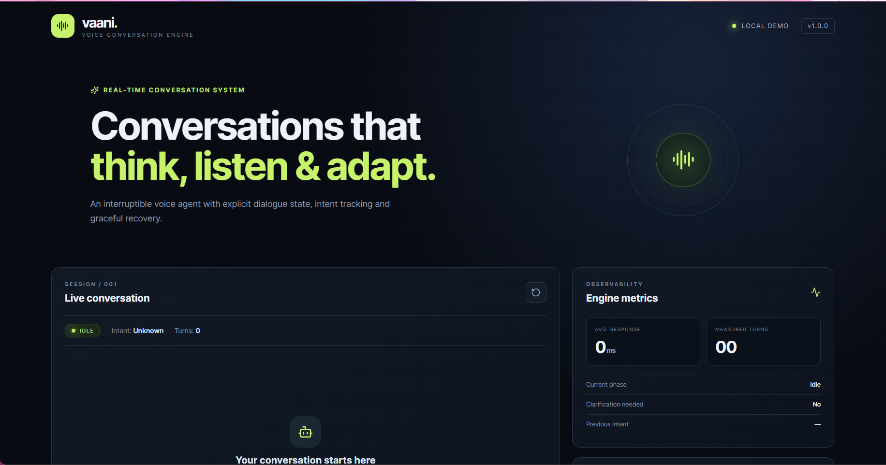
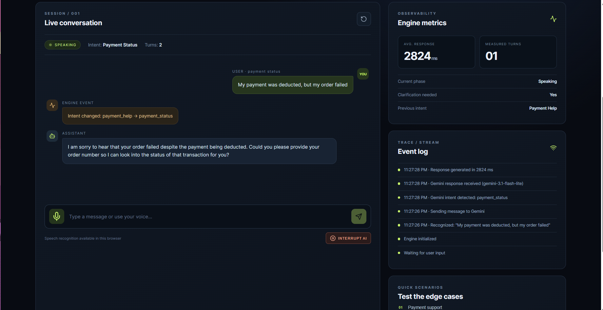
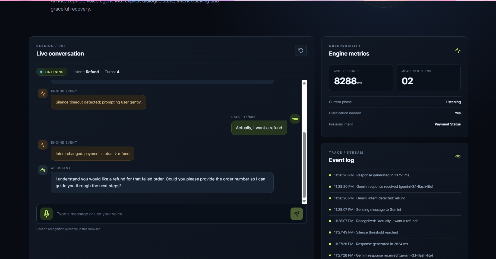

# Vaani — AI-Powered Voice Conversation Engine

Vaani is an interruptible, browser-based AI voice assistant designed to explore the engineering challenges of natural human-computer conversations.

Built as an engineering prototype for the **Voice India AI Conversation Fellow** opportunity, Vaani combines a dialogue state machine, browser-based speech interfaces, and Google's Gemini API to support context-aware, multi-intent conversations.
## 🖥️ Application Preview

Vaani's interface provides a live conversation workspace, AI intent tracking, response-time metrics, and event-level observability.

<p align="center">
  
</p>

### Payment Status Detection

<p align="center">
  
</p>

### Intent Change — Payment Status to Refund

<p align="center">
  
</p>
## ✨ Features

### Conversation Intelligence
- Gemini-powered natural language responses.
- Multi-intent classification across 13 categories.
- Context-aware conversation history.
- Intent-change detection and tracking.
- Clarification handling for incomplete requests.

### Voice Interaction
- Browser speech recognition using the Web Speech API.
- Text-to-speech responses using SpeechSynthesis.
- Interruptible assistant responses (barge-in control).
- Typed input fallback.
- Listening, thinking, speaking, interrupted, and error states.

### Conversation Engineering
- Explicit finite-state machine for dialogue management.
- Previous-intent tracking.
- Silence timeout handling.
- Speech-recognition failure recovery.
- Conversation event history and response timing instrumentation.
- Unit tests for state transitions and edge cases.

### Supported Intent Categories

1. Payment status
2. Payment help
3. Transaction disputes
4. Refunds
5. Account help
6. Technical support
7. Order status
8. Cancellation
9. Greetings
10. Farewells
11. General queries
12. Complaints
13. Unknown intent

## 🏗️ Architecture

```text
             USER
               |
       Microphone / Text
               |
               v
      Browser Speech Adapter
       (Web Speech API)
               |
               v
       React Frontend
       (Conversation UI)
               |
               v
       Conversation Engine
       - Dialogue state
       - Turn management
       - Intent tracking
       - Event history
               |
               v
          Node.js API
          (Express-free HTTP server)
               |
               v
          Google Gemini API
          - Intent understanding
          - Context-aware replies
               |
               v
        Structured AI Response
         { intent, reply }
               |
               v
       Speech Synthesis
               |
               v
       User hears response
```

The conversation engine manages dialogue state independently of the UI and external AI service. The backend keeps the Gemini API key outside the browser.

## 🛠️ Technology Stack

| Layer | Technology |
|---|---|
| Frontend | React, TypeScript |
| Build tool | Vite |
| Backend | Node.js |
| AI model | Google Gemini |
| AI SDK | `@google/genai` |
| Speech input | Web Speech API |
| Speech output | SpeechSynthesis |
| Testing | Vitest |
| Styling | CSS |

## 🚀 Run Locally

### Prerequisites

- Node.js 20+
- npm
- Google Gemini API key
- A compatible browser with microphone access

### 1. Clone the repository

```bash
git clone https://github.com/manish-25-code/vaani-ai-voice-assistant.git
cd vaani-ai-voice-assistant
```

### 2. Install dependencies

```bash
npm install
```

### 3. Configure environment variables

Create a `.env` file in the project root:

```env
GEMINI_API_KEY=your_gemini_api_key
```

Never commit your actual `.env` file or expose your API key in frontend code.

### 4. Start the backend

Open a terminal:

```bash
node server/index.js
```

The backend runs at:

```text
http://localhost:3001
```

### 5. Start the frontend

Open a second terminal:

```bash
npm run dev
```

Open the Vite URL printed in the terminal, usually:

```text
http://localhost:5173
```

Allow microphone access when prompted.

## 🧪 Testing and Production Build

Run unit tests:

```bash
npm test
```

Create a production build:

```bash
npm run build
```

## 💬 Example Conversation Scenarios

**Scenario 1 — Technical support**

User: "My application keeps crashing."

Expected intent: `technical_support`

**Scenario 2 — Refund request**

User: "I want my money back."

Expected intent: `refund`

**Scenario 3 — Transaction dispute**

User: "I was charged twice for the same transaction."

Expected intent: `dispute`

**Scenario 4 — Intent change**

User: "I need help with my payment."

User: "Actually, I want a refund."

Expected behavior: Recognize the change from payment help to refund while preserving conversation history.

**Scenario 5 — Interruption**

Start an assistant response and activate the interrupt control.

Expected behavior: Cancel ongoing speech and return control to the user.

## 🔐 Safety and Scope

- Vaani is a conversational prototype, not a banking or payment-processing application.
- It does not connect to real bank accounts, payment gateways, or customer records.
- It must not claim that transactions or refunds have been verified.
- Gemini API credentials are stored on the backend.
- AI responses are validated before being returned to the frontend.

## ⚠️ Current Limitations

- Speech recognition compatibility varies by browser and locale.
- Speech recognition and synthesis depend on browser capabilities.
- Gemini responses use request-response HTTP communication rather than real-time audio streaming.
- The prototype does not include production telephony, persistent server-side sessions, or a dedicated voice activity detection pipeline.
- Response timing instrumentation should not be interpreted as complete end-to-end audio latency.

## 🔭 Future Improvements

- Streaming speech recognition and partial transcripts.
- Voice activity detection (VAD) and improved barge-in handling.
- End-to-end latency measurement.
- Persistent conversation sessions.
- Expanded dialogue regression tests.
- Structured conversation analytics and event export.
- Improved deployment and production monitoring.

## 👨‍💻 Author

**Manish Sehrawat**

B.Tech — Computer Engineering

GitHub: [manish-25-code](https://github.com/manish-25-code)

Project: [Vaani AI Voice Assistant](https://github.com/manish-25-code/vaani-ai-voice-assistant)

---

*Vaani explores how dialogue state management, intent understanding, voice interaction, and interruption handling can work together to create more natural conversational AI systems.*